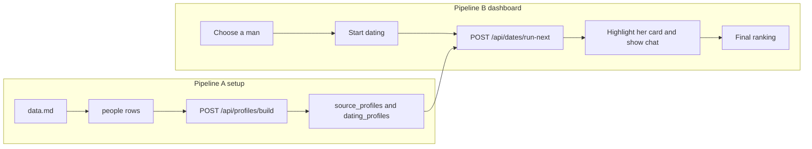

# Two pipelines

The workspace is only [data.md](d:\Agent_Dating_Platform\data.md), [prodcut.md](d:\Agent_Dating_Platform\prodcut.md), and [.env](d:\Agent_Dating_Platform\.env). There is no swipe step.

Profile building and dating never share a request. Dating reads saved rows from Supabase. It does not call Apify.

## What the visitor sees

The dating dashboard only. It should feel like a person reading a profile card, then chatting on your behalf.

1. Open the dashboard and choose one of the 10 men. He is “you” for this run.
2. See the 15 women as profile cards (name, company, needs, hobbies, interests) and a **Start dating** button.
3. Press **Start dating**.
4. Her card highlights. On screen it looks like his agent is reading that card.
5. A proper chat opens. His side sends a message on his behalf. Her side replies. They alternate, three messages each, like two people on a date.
6. The highlight moves to the next card. Read, then the same two-sided chat, until all 15 are done.
7. The final screen is the ranking: who fits him best, with score and reason. A row reopens that saved chat.

## What the visitor does not see

- The real read. The agent loads both dating profiles from Supabase in the background. The card is only the visible stand-in for that read.
- Apify calls, raw LinkedIn text, and raw Instagram text.
- The profile-generation prompt and the script that builds all 25 profiles.
- LangGraph node names.
- Any second scrape during dating. If a profile is missing, dating stops with an error and does not call Apify.

# Pipeline A — profiles, run once at the start

This is project setup. Run it before anyone uses the dashboard.

## App shell and database

Create a Next.js App Router app with TypeScript and Tailwind in `d:\Agent_Dating_Platform`. Add `.gitignore` so `.env` is never committed.

Server code reads `OPENROUTER_API_KEY`, `OPENROUTER_MODEL`, `APIFY_API_TOKEN`, `NEXT_PUBLIC_SUPABASE_URL`, and `SUPABASE_SECRET_KEY`. Browser code never receives the secret key or the Apify token.

Apply SQL on the existing Supabase project. Enable RLS on every table. No anon policies. The server uses the secret key.

- `people`: name, gender, company, linkedin_url, instagram_url
- `source_profiles`: person_id, source (`linkedin` or `instagram`), raw text, scraped_at
- `dating_profiles`: person_id, needs, hobbies, interests, personal_details, uncertainties, summary
- `conversations`: man_id, woman_id, status, score, shared_interests, differences, reason, unique pair
- `messages`: conversation_id, speaker_person_id, body, turn_index

A seed step upserts the 25 people from [data.md](d:\Agent_Dating_Platform\data.md).

## POST /api/profiles/build

One call builds the next person who does not yet have a dating profile.

1. Apify reads that person’s public Instagram profile and public LinkedIn profile.
2. Save both raw results on `source_profiles`.
3. One OpenRouter call (`openai/gpt-4o-mini`) writes structured JSON: needs, hobbies, interests, personal_details, uncertainties, summary.
4. The prompt uses the scraped public text only. It does not invent private romantic history. A thin scrape is saved with explicit uncertainties.
5. Upsert `dating_profiles`.
6. Return `{ completed, total: 25, personName }`.

`npm run build-profiles` loops this endpoint until `completed` is 25 and prints progress in the terminal (`12/25 Namita Thapar`). Re-running skips people who already have a dating profile.

Apify and the analysis agent live only in this pipeline. The dating modules do not import them.

# Pipeline B — dating dashboard

Used only after Pipeline A has saved 25 dating profiles.

## POST /api/dates/run-next

Body: `{ manId }`.

1. Load his dating profile from Supabase.
2. Find the next woman with no conversation for this man.
3. Load her dating profile from Supabase.
4. Return her id immediately in the response metadata so the UI can highlight her card before the chat is shown. The route still finishes the date in that same call, and the client highlights as soon as the request starts, using the woman id it already knows from the remaining list.
5. LangGraph date, using `@langchain/langgraph`. Both speakers use only the profiles loaded from Supabase:
   - His turn: one dating message written on his behalf, from his needs, hobbies, interests, and personal details.
   - Her turn: she replies from her own profile.
   - Repeat until 6 messages, 3 each. The transcript is a real back-and-forth, not a summary.
   - Judge: score 0–100, shared interests, differences, and a short reason.
   - Save `conversations` and `messages`.
6. Return the woman, the transcript, the score, and `{ done, total: 15 }`.

The client calls `run-next` until `done === 15`. One HTTP call is one woman, so a full run cannot die inside a single long request. A pair that already exists is not generated again.

## Dashboard screens

- **Home:** 10 men. Choosing one opens his dating board. This board is empty of chats until **Start dating**.
- **Dating board:** 15 profile cards. **Start dating** loops `run-next`. The active card is highlighted so it feels like that profile is being read. Supabase is what the agent actually reads.
- **Chat:** a two-column thread. Left messages are on behalf of the man you chose. Right messages are her replies. Names label each bubble. The thread fills in as the date finishes, then the highlight moves to the next woman.
- **Final result:** after 15/15, the board becomes the ranking, best score first. Each row reopens that same two-sided transcript. Copy says these are simulated agents speaking on behalf of each person.

# Check

1. Run `npm run build-profiles` and confirm 25 `dating_profiles` rows. Confirm a date route does not call Apify.
2. Open the dashboard, choose Aman Gupta, press **Start dating**.
3. Confirm each woman’s card highlights, then a 6-message chat shows his messages and her replies in turn.
4. Confirm the final view ranks them, including Falguni Nayar, and a second visit reuses the saved chats.
