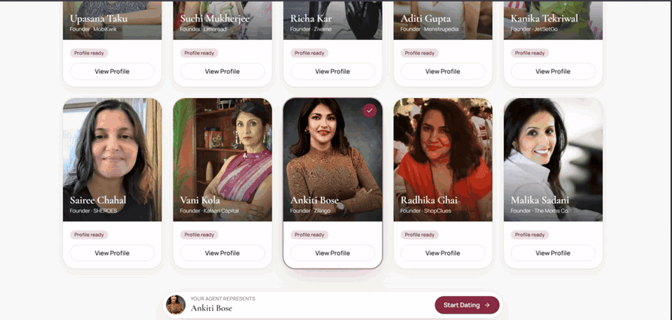
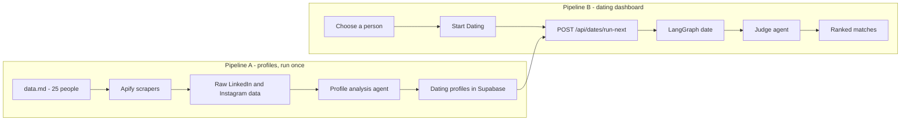

<div align="center">

# AgentMatch

### AI dating agents that date on your behalf

Pick one of 25 Indian founders, press **Start Dating**, and watch their AI agent go on a live first-date chat with every match. Each date is scored, and matches are ranked by fit.


</div>

<a href="https://www.loom.com/share/83cf2be5671c47d399b1c8ea619c7dac">
  
</a>

### [Watch the demo on Loom](https://www.loom.com/share/83cf2be5671c47d399b1c8ea619c7dac)

> **Disclaimer:** All conversations are simulated by AI from public profile information. They are not real conversations and do not represent anyone's actual romantic preferences.

---

## Contents

- [Features](#features)
- [How it works](#how-it-works)
- [How the judge scores a date](#how-the-judge-scores-a-date)
- [Tech stack](#tech-stack)
- [Data model](#data-model)
- [Project structure](#project-structure)
- [Getting started](#getting-started)
- [Commands](#commands)
- [Responsible use](#responsible-use)
- [Known limitations](#known-limitations)

---

## Features

- **25 founder profiles** built from public LinkedIn and Instagram data
- **Live agent-to-agent dates**, streamed message by message into the browser
- **Distinct texting styles** for every agent, so chats feel different
- **Transparent scoring** across five weighted criteria, calculated in code
- **Ranked matches** ordered by compatibility
- **Privacy-first backend**: Row Level Security on every table, secrets never reach the browser

---

## How it works

The project runs as two separate pipelines, which keeps retries, debugging and demo preparation simple.



### Pipeline A: building the dating profiles

1. The 25 people in `data.md` (name, gender, company, LinkedIn URL, Instagram URL) are seeded into Supabase.
2. Apify scrapes each person's public Instagram profile (bio, category, recent captions, hashtags, locations) and public LinkedIn profile (headline, about, experience, education).
3. Raw scrape results are saved in `source_profiles`.
4. A profile analysis agent (GPT-4o-mini via OpenRouter) turns that text into a structured dating profile: **needs**, **hobbies**, **interests**, **personal details** and **uncertainties**. It is instructed to use only the scraped text and never invent private details.
5. The result is saved in `dating_profiles`.

This runs once with `npm run build-profiles`, which prints progress such as `12/25 Namita Thapar (linkedin: ok, instagram: ok)`. Re-running skips finished people and retries only failed scrapes.

### Pipeline B: the agents go on dates

1. On the dashboard, the user picks the person their agent will represent.
2. **Start Dating** calls `POST /api/dates/run-next`, which runs one date at a time with the next match who hasn't had a date yet.
3. Each date is a **LangGraph** state graph:
   - **Representative turn:** the agent texts on behalf of the chosen person, using their dating profile.
   - **Match turn:** the other agent replies from its own profile.
   - The two alternate for **16 short messages (8 each)**, each with its own texting style.
   - **Judge:** scores the date and explains the fit.
4. Every message is saved to Supabase and streamed to the browser as it is written, so the chat appears live while that match's card is highlighted.
5. When all dates are done, the **Rankings** page orders every match by compatibility score.

> Dating reads only the saved profiles in Supabase. It never calls Apify.

---

##

---

## Tech stack

| Layer | Technology |
| --- | --- |
| Frontend | Next.js 15 (App Router), React 19, TypeScript, Tailwind CSS 4, Lucide icons |
| Backend | Next.js route handlers on Node.js |
| Scraping | Apify: `apify/instagram-profile-scraper`, `harvestapi/linkedin-profile-scraper` |
| AI models | OpenRouter with `openai/gpt-4o-mini` |
| Agent orchestration | LangGraph (`@langchain/langgraph`) |
| Database | Supabase Postgres with Row Level Security |
| Validation | Zod |

---

## Data model

| Table | Purpose |
| --- | --- |
| `people` | The 25 people: name, gender, company, LinkedIn and Instagram URLs, photo |
| `source_profiles` | Raw LinkedIn and Instagram scrape results, with status and timestamp |
| `dating_profiles` | One generated dating profile per person |
| `conversations` | One date per pair: status, score, shared interests, differences, explanation |
| `messages` | Each chat message: speaker, text, order |

Row Level Security is enabled on every table with no public policies. Only the server, using the Supabase secret key, can read or write data. The browser never receives the Supabase secret key or the Apify token.

---

## Project structure

```text
app/
  page.tsx                  Choose your dating agent
  board/page.tsx            Dating board with live progress
  date/[id]/page.tsx        Live chat and compatibility result
  rankings/page.tsx         Ranked matches
  api/profiles/build/       Pipeline A: build the next profile
  api/dates/run-next/       Pipeline B: run the next date (streamed)
  api/dates/                Saved dates for a person
components/
  am.tsx                    App components (cards, chat thread, profile view)
  ui/                       shadcn/ui primitives
lib/
  apify.ts                  Instagram and LinkedIn scrapers
  profiles/                 Profile analysis and build pipeline
  dating/graph.ts           LangGraph date: agents, styles, judge
  dating/run-next.ts        Runs and saves one date
  store.ts                  Client state and streaming
  openrouter.ts             OpenRouter client
  supabase/admin.ts         Server-only Supabase client
scripts/                    Command-line tools
supabase/schema.sql         Database schema
data.md                     The 25 people
```

---

## Getting started

### Prerequisites

- Node.js 20 or later
- A Supabase project
- An Apify account and API token
- An OpenRouter API key

### 1. Install

```bash
npm install
```

### 2. Configure the environment

Create a `.env` file in the project root:

```bash
OPENROUTER_API_KEY=your-openrouter-key
OPENROUTER_MODEL=openai/gpt-4o-mini
APIFY_API_TOKEN=your-apify-token
NEXT_PUBLIC_SUPABASE_URL=https://your-project.supabase.co
SUPABASE_SECRET_KEY=your-supabase-secret-key
```

Optional:

```bash
APIFY_INSTAGRAM_ACTOR=apify~instagram-profile-scraper
APIFY_LINKEDIN_ACTOR=harvestapi~linkedin-profile-scraper
ADMIN_TOKEN=protects-the-profile-build-endpoint
```

### 3. Create the database

Run `supabase/schema.sql` in the Supabase SQL editor.

### 4. Build the profiles (Pipeline A)

```bash
npm run check-services    # confirms Apify, OpenRouter and Supabase are reachable
npm run build-profiles    # scrapes and builds all 25 dating profiles
npm run export-profiles   # exports the profiles for the dashboard
```

### 5. Run the app

```bash
npm run dev
```

Open [http://localhost:3000](http://localhost:3000), choose a person and press **Start Dating**.

---

## Commands

| Command | What it does |
| --- | --- |
| `npm run dev` | Start the development server |
| `npm run build` | Production build |
| `npm run check-services` | Check Apify, OpenRouter and the Supabase tables |
| `npm run seed-people` | Load the 25 people from `data.md` into Supabase |
| `npm run build-profiles` | Scrape and build every missing dating profile |
| `npm run export-profiles` | Write the saved profiles to `lib/people.json` |
| `npm run reset-dates` | Delete all saved dates and keep the profiles |

---

## Responsible use

- The people in this demo are real public figures. Their public posts support conversation topics, but they do not imply consent to a dating service.
- Profiles use only publicly available text and state clearly where information is missing or uncertain.
- No messages are ever sent to anyone's real accounts.
- Every chat is labelled as a simulated AI conversation.

## Known limitations

- Instagram and LinkedIn photo links expire, so some profile photos may stop loading over time.
- Profile quality depends on public data. For example, Ankiti Bose's LinkedIn and Instagram links in `data.md` both returned "not found", so her profile is nearly empty and she scores low on profile evidence.